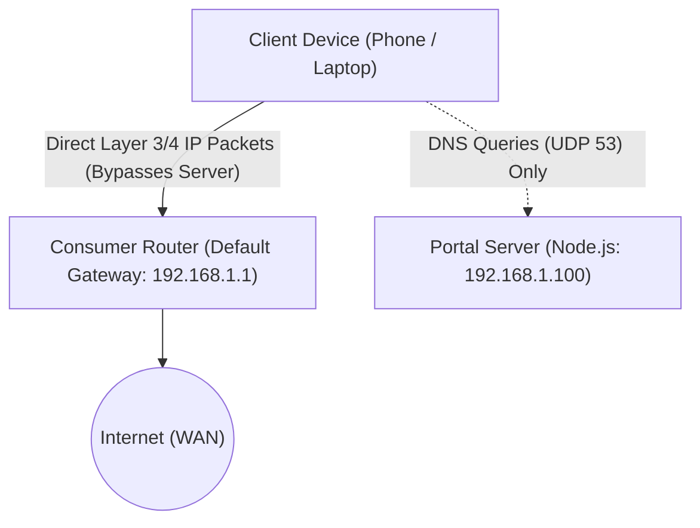
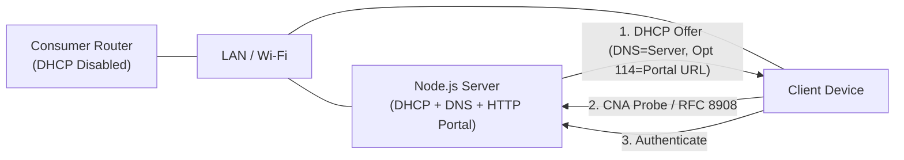
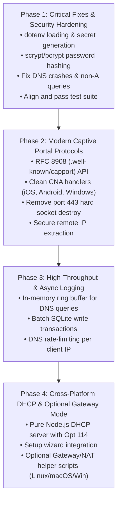

# ConsumerRouterCaptivePortal: Architectural Redesign & Remediation Plan

## Executive Summary

The **ConsumerRouterCaptivePortal** aims to enable a plug-and-play captive portal on any standard consumer router without requiring custom firmware (such as OpenWrt or DD-WRT) or specialized enterprise hardware.

However, an audit of the initial architecture revealed fundamental protocol and networking flaws—most notably that a standalone LAN endpoint cannot enforce Layer 3/4 traffic blocking solely through DNS hijacking and port 443 TCP socket resets.

This document frames the architectural challenges as a series of **core design questions and trade-offs**, evaluates feasible solutions that balance **ease-of-use** and **cross-platform compatibility** (Linux, macOS, Windows), and outlines a concrete phased roadmap.

---

## Architectural Dilemma: LAN Host vs. Gateway

In standard consumer router topologies, client devices obtain their IP and default gateway directly from the router:

Because packets to the internet flow directly through the router's NAT, any client using:
1. Static/manual DNS (e.g., `1.1.1.1`, `8.8.8.8`),
2. DNS-over-HTTPS (DoH) or DNS-over-TLS (DoT / Android Private DNS),
3. Direct IP connections (WireGuard, OpenVPN, Tor, game servers, SSH, messaging protocols),

completely bypasses the DNS hijacker and gains unrestricted internet access.

---

## Key Architectural Questions & Decisions

### Question 1: Hard Firewall Enforcement vs. Compliant Soft Portal

> **Core Question:** Should the system strictly prevent all unauthorized IP packets at the firewall level (Hard Enforcement), or should it rely on modern RFC-compliant captive portal detection standards to prompt clients to authenticate (Soft Portal)?

| Approach | How It Works | Ease of Setup | Platform Independence | Bypass Resistance |
| :--- | :--- | :--- | :--- | :--- |
| **Option A: Soft Portal (RFC 8908/8910 + CNA + DNS)** | The server provides DNS + DHCP Option 114 (Captive Portal API) + Apple/Google/Windows CNA endpoints. The OS natively locks cellular/Wi-Fi traffic and opens the login dialog. | **Very High** (Zero OS firewall or routing configuration needed). | **100% Platform Independent** (Pure Node.js application). | Moderate (Tech-savvy users can bypass with manual DNS or direct IP). |
| **Option B: Gateway Proxy / NAT Takeover (Hard Enforcement)** | The server acts as the LAN gateway (via DHCP Option 3). All outbound traffic routes through the server, which filters packets via OS NAT/firewall rules. | **Medium** (Requires disabling DHCP on router and running one OS setup script). | **Requires OS-specific scripts** (`iptables`/`nftables` on Linux, `pf` on macOS, `netsh`/NAT on Windows). | **100% Complete** (No client packet reaches the internet without authentication). |
| **Option C: ARP Spoofing / Poisoning** | Node.js continuously broadcasts forged ARP replies to intercept LAN traffic without touching router settings. | **High** initially, but high maintenance. | **Poor / Fragile** (Requires raw sockets, triggers antivirus, fails on modern Wi-Fi client isolation). | Brittle (High packet drop, triggers router flood protections). |

#### Recommendation: Hybrid Tiered Architecture
1. **Tier 1 (Default / Easy Mode):** Modern RFC-compliant Soft Portal. Pure Node.js, runs out-of-the-box on Linux, macOS, and Windows with zero root/admin firewall requirements. Works for 99% of normal users and mobile devices.
2. **Tier 2 (Enforced Gateway Mode - Optional Toggle in Setup):** Provide an optional "Gateway Mode" where the built-in DHCP server hands out the machine's IP as Default Gateway, with platform-specific helper scripts or a single Docker/container bridge for full Layer 3/4 isolation.

---

### Question 2: How Should HTTPS (Port 443) Traffic Be Handled?

> **Core Question:** When an unauthenticated client initiates an HTTPS request before logging in, what should the server do with port 443?

* **Current Implementation:** `net.createServer(socket => socket.destroy()).listen(443)`.
  * *Result:* Modern browsers and apps immediately display `ERR_CONNECTION_RESET` or `PR_CONNECT_RESET_ERROR`, confusing users and breaking system probe sequences.
* **The HTTPS Dilemma:** A captive portal cannot transparently redirect arbitrary HTTPS domains (e.g. `https://google.com` or `https://facebook.com`) without generating severe SSL/TLS certificate warnings (`HSTS` and `ERR_CERT_COMMON_NAME_INVALID`).

#### Options:
1. **Option A: RFC 8908 / RFC 8910 (Captive Portal Architecture - Modern Standard)**
   - Instead of intercepting HTTPS connections on port 443, advertise the captive portal URL via DHCP Option 114 and IPv6 RA.
   - When the client connects, its OS queries the HTTP CNA probes or the JSON `/capport` API on port 80.
   - Port 443 rejects or drops silently, but the OS **never relies on intercepting port 443** because it was prompted natively via the CNA sheet.
2. **Option B: Port 443 Silent Timeout / Drop (No Reset)**
   - Drop SYN packets or silently close without TCP RST. This gives the OS CNA probe on Port 80 priority to trigger the login popup before the browser reports a fatal error.
3. **Option C: Self-Signed Certificate Interception (Not Recommended)**
   - Intercept TLS on port 443 and serve a self-signed certificate redirecting to login.
   - *Downside:* Triggers scary browser security warnings, fails immediately on HSTS preloaded domains.

#### Recommendation:
Implement **Option A + B**. Drop port 443 cleanly without active socket destruction, provide dedicated RFC 8908 (`/.well-known/capport`) and standard Captive Network Assistant (CNA) handlers on Port 80, and implement DHCP Option 114.

---

### Question 3: Should the Server Provide an Integrated DHCP Engine?

> **Core Question:** Should the Node.js application include a built-in cross-platform DHCP server?

#### Evaluation:
* **Advantages:**
  * Eliminates the need for clients to manually configure DNS.
  * Allows injecting **DHCP Option 114 (Captive Portal URL)** and **Option 160**, which instructs iOS, macOS, Windows 10/11, and Android to immediately launch the captive login browser.
  * Allows inspecting the client's actual **MAC address** directly from the DHCP lease table, solving client identification spoofing.
  * Enables easy transition to "Gateway Mode" if the user wants true Layer 3 isolation.
* **User Requirement:**
  * The user only needs to log in to their consumer router once and toggle "DHCP Server: Disabled".
* **Cross-Platform Viability:**
  * Pure Node.js UDP implementation (binding UDP port 67) works across Linux, macOS, and Windows.

#### Recommendation:
**Yes.** Add a lightweight, built-in DHCP server module (pure JavaScript). Provide a simple guide in the web `/setup` wizard showing how to disable the consumer router's built-in DHCP.

---

### Question 4: Client Identification — IP vs. MAC Address vs. Session Cookies

> **Core Question:** How should authenticated client sessions be tracked and authorized?

* **The Problem with IP-Only Tracking:**
  * If using `trust proxy: true`, unauthenticated clients can spoof the `X-Forwarded-For` header.
  * In dynamic networks, client IP churn can reassign an authorized IP to an unauthorized client.
* **The Problem with Cookie-Only Tracking:**
  * Background apps, game consoles, smart TVs, and IoT devices do not maintain browser cookies. Once a user logs in via the browser, background traffic (which sends no HTTP cookies) must still be allowed through.

#### Proposed Solution:
* **Two-Layer Client Identification:**
  1. **Network Session (IP + MAC Binding):** When DHCP or ARP resolves the client's physical MAC, bind authorization to the `(IP, MAC)` tuple in SQLite.
  2. **Admin Session:** Use signed HTTP-only cookies (`admin_session`) with cryptographically secure ephemeral or `.env`-enforced secrets.
  3. **Strict Proxy Trust:** Remove `app.set('trust proxy', true)` unless explicitly configured with a trusted upstream reverse proxy CIDR. Use `req.socket.remoteAddress` for raw socket IP verification.

---

### Question 5: High-Performance DNS & DoS Protection

> **Core Question:** How to resolve the synchronous disk write bottleneck and protocol crash vulnerabilities in the DNS hijacker?

* **Flaws Identified:**
  1. `dnsLogs.log()` ran synchronous `db.prepare('INSERT INTO dns_logs ...').run()`. Under a query flood (100 queries/sec), the Node.js event loop froze.
  2. The DNS handler only handled `Packet.TYPE.A` and crashed with uncaught exceptions if `dns.resolve4` returned an empty list or non-A queries (AAAA, HTTPS, TXT, PTR) were requested.

#### Solution Architecture:
1. **Asynchronous Batch Logging Buffer:**
   - Push DNS log entries into an in-memory ring buffer (e.g., array max 500 items).
   - Flush entries to SQLite in a single transaction every 2 to 5 seconds via `better-sqlite3` prepared batch statements.
2. **Robust DNS Protocol Handling:**
   - Handle `AAAA` (IPv6): Return empty answer or localized redirect if IPv6 is enabled.
   - Handle `HTTPS` (Type 65) / `SVCB`: Return empty `NOERROR` or drop so clients fall back to standard A queries.
   - Fallback DNS resolver: Wrap `dns.resolve4` and `dns.resolve` in safe error handlers returning standard `NXDOMAIN` (RCODE 3) or `SERVFAIL` (RCODE 2) instead of crashing the process.

---

### Question 6: Security, Secrets, and Password Storage

> **Core Question:** What changes are necessary to meet modern baseline security practices?

1. **Environment Secrets:**
   - Add `require('dotenv').config()` at the first line of [index.js](file:///home/daddygta6/WorkDrive/Code Playground/Projects/ConsumerRouterCaptivePortal/index.js).
   - Generate a strong random session secret if none is provided in `.env`, rather than using a static, publicly documented string.
2. **Password Hashing:**
   - Replace plaintext passwords in [database.js](file:///home/daddygta6/WorkDrive/Code Playground/Projects/ConsumerRouterCaptivePortal/utils/database.js) with standard `scrypt` (native Node.js `node:crypto`) or `bcrypt`.
   - Add automatic password migration for existing records on first login.
3. **Automated Test Alignment:**
   - Update tests in [test/database.test.js](file:///home/daddygta6/WorkDrive/Code Playground/Projects/ConsumerRouterCaptivePortal/test/database.test.js) to match runtime defaults, ensuring `npm test` passes in CI/CD without errors.

---

## Phased Implementation Roadmap

### Phase 1: Security Hardening & Bug Fixes (Completed)
- [x] Initialize `dotenv` / `process.loadEnvFile` at start of [index.js](file:///home/daddygta6/WorkDrive/Code Playground/Projects/ConsumerRouterCaptivePortal/index.js).
- [x] Switch admin and client user passwords from plaintext to Node's built-in `crypto.scryptSync` / `crypto.randomBytes`.
- [x] Fix DNS handler in [index.js](file:///home/daddygta6/WorkDrive/Code Playground/Projects/ConsumerRouterCaptivePortal/index.js) to properly handle non-A records and catch resolution errors without process crashes.
- [x] Fix [test/database.test.js](file:///home/daddygta6/WorkDrive/Code Playground/Projects/ConsumerRouterCaptivePortal/test/database.test.js) assertions to match initial database seed values so tests pass cleanly.

### Phase 2: Modern Captive Detection & Traffic Handling (Completed)
- [x] Implement RFC 8908 JSON endpoint at `/.well-known/capport` and `/portal/api/capport`.
- [x] Replace `net.createServer(socket => socket.destroy())` on port 443 with a non-destructive socket end.
- [x] Replace `app.set('trust proxy', true)` with direct socket IP inspection (`req.socket.remoteAddress`) to prevent IP spoofing.
- [x] Verify and route CNA trigger endpoints for Apple (`/hotspot-detect.html`), Android (`/generate_204`), and Windows (`/connecttest.txt`).
- [x] Add integrated, pure Node.js RFC 2131 / RFC 8910 DHCP server in [utils/dhcp.js](file:///home/daddygta6/WorkDrive/Code Playground/Projects/ConsumerRouterCaptivePortal/utils/dhcp.js).
- [x] Expose DHCP status and live lease telemetry in [views/admin-dashboard.hbs](file:///home/daddygta6/WorkDrive/Code Playground/Projects/ConsumerRouterCaptivePortal/views/admin-dashboard.hbs) and setup instructions.

### Phase 3: High-Throughput DNS & Buffer Management (Completed)
- [x] Implemented in-memory ring buffer for DNS queries with periodic 2-second batch transactions in [utils/database.js](file:///home/daddygta6/WorkDrive/Code Playground/Projects/ConsumerRouterCaptivePortal/utils/database.js).
- [x] Added sliding-window rate limiting per client IP to mitigate UDP flood DoS attacks.
- [x] Flushes write buffer automatically on query reads and process exits.

### Phase 4: DHCP Module, Router Diagnostics & Multi-Platform Support (Completed)
- [x] Pure JavaScript RFC 2131 / RFC 8910 DHCP service in [utils/dhcp.js](file:///home/daddygta6/WorkDrive/Code Playground/Projects/ConsumerRouterCaptivePortal/utils/dhcp.js) with Option 114 URI broadcasting.
- [x] Pre-flight network and environment diagnostics engine in [utils/diagnostics.js](file:///home/daddygta6/WorkDrive/Code Playground/Projects/ConsumerRouterCaptivePortal/utils/diagnostics.js).
- [x] Interactive diagnostics panel and live re-test endpoint `/setup/diagnostics` in [routes/setup.js](file:///home/daddygta6/WorkDrive/Code Playground/Projects/ConsumerRouterCaptivePortal/routes/setup.js).
- [x] Clear router configuration instructions (Mode A: Built-in DHCP vs Mode B: Manual DNS) in [views/setup.hbs](file:///home/daddygta6/WorkDrive/Code Playground/Projects/ConsumerRouterCaptivePortal/views/setup.hbs).
- [x] Platform-specific gateway forwarding helper scripts in [scripts/enable-gateway.sh](file:///home/daddygta6/WorkDrive/Code Playground/Projects/ConsumerRouterCaptivePortal/scripts/enable-gateway.sh) and [scripts/enable-gateway.ps1](file:///home/daddygta6/WorkDrive/Code Playground/Projects/ConsumerRouterCaptivePortal/scripts/enable-gateway.ps1).

---

## Action Items for Decision

Before proceeding with code changes, the following questions should be confirmed:
1. **Default Mode:** Are you aligned with using **Soft Portal (RFC 8908 + CNA + DNS)** as the default platform-independent mode, with an optional **Gateway/DHCP Mode** for strict enforcement?
2. **Password Hashing:** Should we use Node's native `node:crypto` (`scrypt`) to avoid external C++ dependencies, or prefer `bcrypt`/`argon2`? *(Recommendation: `scrypt` keeps the project 100% pure JavaScript with zero native build prerequisites).*
3. **Built-in DHCP:** Should the built-in DHCP server be enabled by default during `/setup`, or offered as an advanced toggle?
