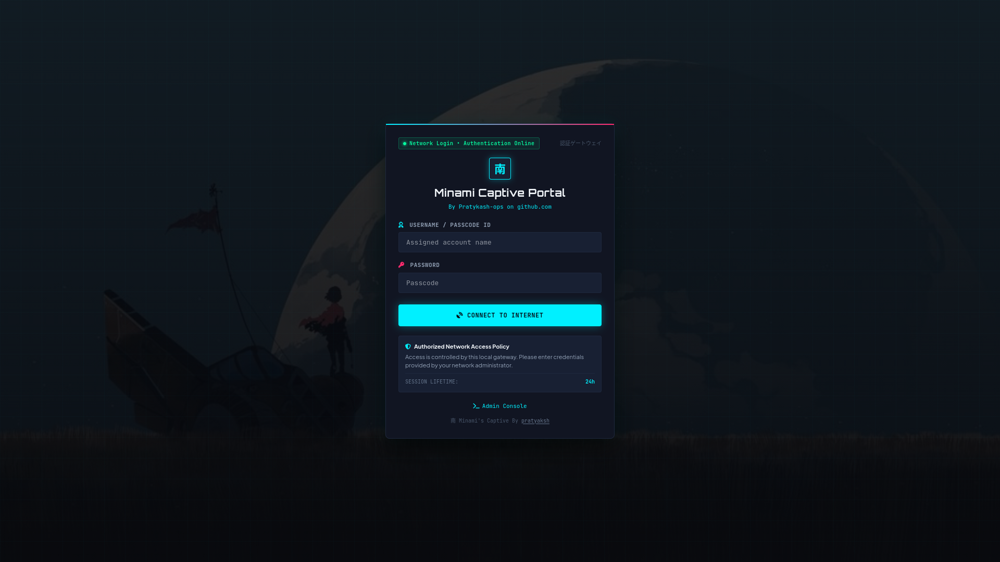
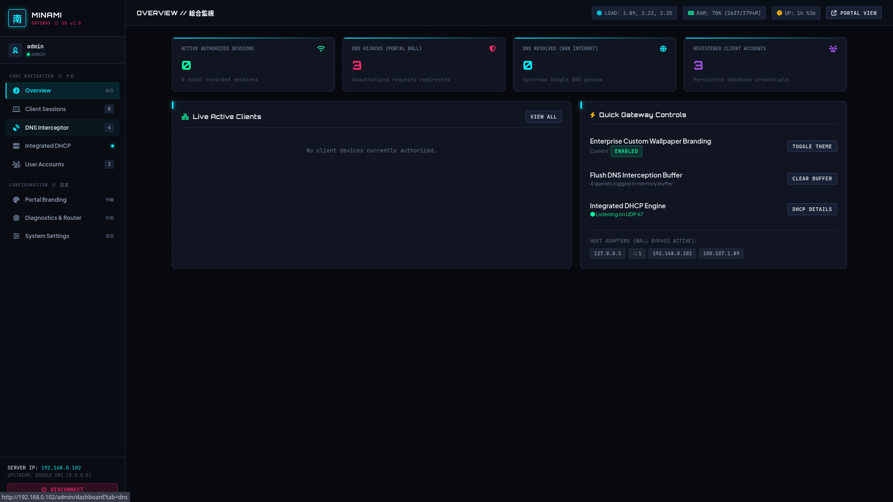
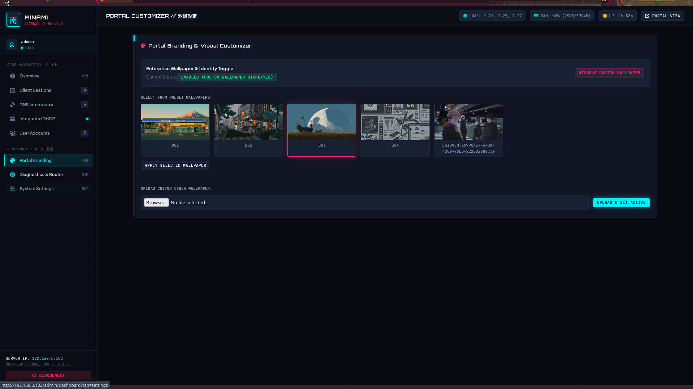
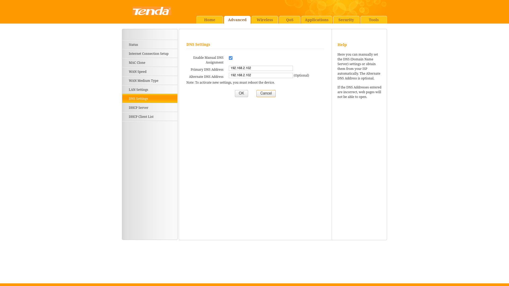
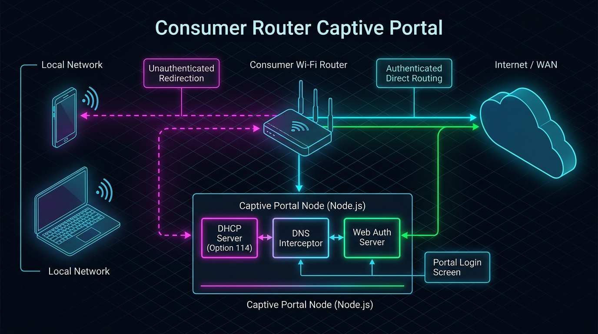

# 南 // Minami's Captive Gateway

> **A standalone, plug-and-play captive portal designed for standard consumer routers.**  
> Transform any everyday home or office router into a full-featured commercial captive portal without flashing custom firmware (like OpenWrt or DD-WRT) or purchasing expensive enterprise hardware.

---

## 📸 Screenshots Showcase

### 1. Client Captive Portal Screen
Modern cyberpunk authentication gateway with live status indicators, network policy announcements, and customizable enterprise branding.


---

### 2. Multi-Page Terminal Command Console
Full-screen Japanese cyberpunk administrative dashboard featuring live CPU/RAM/Uptime telemetry, client session controls, and quick gateway toggles.


---

### 3. Portal Visual Customizer & Wallpaper Gallery
Custom wallpaper gallery with instant theme preview, enterprise logo/tagline customization, and image uploader.


---

### 4. Consumer Router Configuration
Step-by-step guidance on setting static DHCP reservations and routing Primary DNS directly to the portal server.


---

## ⚡ How It Works

Standard consumer routers do not provide built-in captive portal redirect engines. **Minami's Captive** solves this at Layer 2/3/4 by acting as an intelligent local gateway service on your LAN.

### 🌐 Network Architecture & Flow


1. **Client Connects to Wi-Fi:** When a smartphone, laptop, or tablet joins the router's Wi-Fi network, it broadcasts a DHCP request.
2. **Integrated DHCP & RFC 8910 Announcement:**
   * In **Mode A (Recommended)**, the portal's built-in DHCP server replies with an IP address, sets this machine as the primary DNS server (Option 6), and broadcasts **DHCP Option 114 (Captive Portal URI)**.
   * Modern operating systems (iOS 14+, Android 9+, Windows 10/11, macOS) immediately detect Option 114 and trigger the native system login sheet.
3. **DNS Interception:**
   * If a device queries unauthenticated external domains (e.g. `google.com`), the built-in UDP port 53 DNS interceptor spoofs the response to point to the portal's web server IP.
   * Authenticated client queries are forwarded upstream to Google DNS (`8.8.8.8` / `8.8.4.4`).
4. **Traffic Enforcement Middleware:**
   * Unauthenticated HTTP requests on Port 80 are redirected (HTTP 302) to `/portal/login`.
   * Standard Captive Network Assistant (CNA) probes (`/generate_204`, `/hotspot-detect.html`, `/ncsi.txt`) and RFC 8908 (`/.well-known/capport`) endpoints pass through cleanly.
   * Port 443 HTTPS requests are gracefully closed without violent TCP resets, preventing scary browser connection failure screens.
5. **Authentication & Session Unlock:**
   * The client logs in with assigned credentials or voucher codes.
   * The server records the authenticated session `(IP, MAC, ExpiresAt)` in SQLite.
   * Outbound internet access is immediately unlocked for the client for the duration configured by the operator.

---

### 🏯 Conceptual Architecture


---

## 🚀 Key Features

* **🖥️ Full-Screen Japanese Cyberpunk Command Deck:**
  * Clean, responsive 8-module administrative workspace with fixed sidebar navigation and top telemetry bar.
  * Dedicated modules for **Overview**, **Client Sessions**, **DNS Interceptor**, **Integrated DHCP**, **User Accounts**, **Portal Branding**, **Network Diagnostics**, and **System Settings**.
  * Japanese aesthetics with minimalist cyber accents (`南` Minami, `通` Transit, `認証ゲートウェイ` Auth Gateway).
* **📡 Integrated RFC 2131 & RFC 8910 DHCP Engine:**
  * Pure Node.js UDP implementation (Port 67) broadcasting Option 114 (Captive Portal URI) for zero-config client discovery.
* **🛡️ High-Throughput Async DNS Interceptor:**
  * In-memory ring buffer with periodic 2-second SQLite batch write transactions.
  * Sliding-window per-IP rate limiting preventing UDP flood DoS attacks.
  * IPv6 `AAAA` handling and non-crashing `NXDOMAIN` / `SERVFAIL` fallbacks.
* **🔍 Pre-Flight Diagnostics & Router Verifier:**
  * Auto-detects primary LAN IP, subnet, and default router gateway.
  * Probes router reachability and actively tests whether router DNS points to the portal machine.
  * Advises and verifies permanent Static IP / DHCP Address Reservation.
  * Real-time in-browser **"Re-Run Diagnostics"** button.
* **🔒 Hardened Security:**
  * Password hashing via Node's native `node:crypto` (`scrypt`) with cryptographic salts and constant-time verification.
  * Direct socket remote IP extraction (`req.socket.remoteAddress`) preventing `X-Forwarded-For` header spoofing.
  * Cryptographically secure ephemeral session secrets.
* **🎨 Enterprise Customizer & Wallpaper Gallery:**
  * One-click toggle between minimalist dark cyber theme and personalized organization branding.
  * Built-in wallpaper gallery and custom background uploader.

---

## 🛠️ Required Consumer Router Configuration

Configure your consumer router using one of the two modes below:

### ⚠️ Step 0: Set Static IP or DHCP Reservation in Router (Crucial)
Before changing DNS or DHCP settings, bind your server's IP in your router's **DHCP Static Leases / Address Reservation** menu:
* **Server IP:** `192.168.0.x` (Your detected server IP)
* **Server MAC Address:** Find your primary adapter MAC in `/setup` or `/admin/dashboard?tab=diagnostics`
> *Why? This guarantees the router never reassigns a new IP to the server machine upon rebooting.*

---

### MODE A: Built-in DHCP Server (Recommended — Zero Client Config)
1. Open your router administration page (e.g. `http://192.168.0.1` or `http://192.168.1.1`).
2. Navigate to **LAN / DHCP Server Settings**.
3. Set **DHCP Server: Disabled (or OFF)**.
4. Run this server with elevated privileges (`sudo npm start`).
> *The built-in DHCP server will automatically assign IP addresses, set this machine as DNS, and announce the captive login portal to connecting smartphones and PCs.*

---

### MODE B: Manual Router DNS (Leave Router DHCP Enabled)
1. Open your router administration page.
2. Navigate to **LAN / DHCP Server Settings**.
3. Set **Primary DNS (DNS 1)** to your server machine's IP address.
4. Leave **Secondary DNS** blank.
> *⚠️ IMPORTANT: Do NOT enter 8.8.8.8 or 1.1.1.1 as secondary DNS, as modern clients will use it to bypass the login screen!*

---

## 📦 Installation & Quick Start

### 1. Prerequisites
* **Node.js:** v18.0.0 or later (v20+ recommended).
* **Operating System:** Linux, macOS, or Windows.
* **Permissions:** Root / Administrator privileges (to bind ports 80, 53, and 67).

### 2. Clone & Install Dependencies
```bash
git clone https://github.com/pratykash-ops/ConsumerRouterCaptivePortal.git
cd ConsumerRouterCaptivePortal
npm install
```

### 3. Launch Initial Setup Wizard
```bash
# Start the server (run with sudo for ports 80, 53, 67)
sudo npm start
```
Open your browser and navigate to:
```
http://localhost/setup
```
* Review the **Pre-Flight Diagnostics** (verifies LAN IP, router reachability, static IP, DNS delegation, and port bindings).
* Configure your local domain (default: `myportal.sc`), session duration, and admin credentials.
* Click **Complete Setup & Launch Gateway Portal**.

### 4. Admin Management Console
Once setup is complete, access the multi-page terminal dashboard at:
```
http://<YOUR_SERVER_IP>/admin/login
```

---

## 📂 Project Architecture

```
├── config/
│   └── constants.js             # Centralized ports, upstream DNS, session & probe defaults
├── middleware/
│   ├── traffic.js               # Safe remote IP extraction & captive traffic enforcement
│   └── auth.js                  # Admin session verification & requireAdmin route guards
├── services/
│   ├── dns.js                   # DNS Hijacker server, upstream resolver & safe error handling
│   └── https.js                 # HTTPS Port 443 graceful rejector service
├── utils/
│   ├── dhcp.js                  # Pure Node.js RFC 2131 & RFC 8910 DHCP server engine
│   ├── diagnostics.js           # Pre-flight environment, router reachability & DNS checks
│   ├── database.js              # Scrypt password hashing & async batch DNS query logger
│   ├── helpers.js               # Dynamic portal config & authorization evaluator
│   ├── icons.js                 # Flat vector SVG icon rendering engine
│   ├── network.js               # Host interface auto-detection & system metrics
│   └── wallpaper.js             # Wallpaper management & image upload handler
├── routes/
│   ├── setup.js                 # Setup wizard with live /setup/diagnostics endpoint
│   ├── admin.js                 # Protected admin console, telemetry & user management
│   └── portal.js                # Captive login, RFC 8908 (.well-known/capport) & CNA probes
├── scripts/
│   ├── enable-gateway.sh        # Optional Linux NAT masquerade & packet forwarding
│   └── enable-gateway.ps1       # Optional Windows IPv4 routing helper
├── public/
│   ├── images/                  # Architecture diagrams & preset wallpapers
│   └── screenshot/              # UI screenshots
├── views/
│   ├── layouts/main.hbs         # Full-screen cyberpunk layout with FontAwesome 6
│   ├── admin-dashboard.hbs      # 8-module multi-page admin terminal console
│   ├── admin-login.hbs          # Cyberpunk terminal login console
│   ├── login.hbs                # Client-facing captive login portal
│   ├── dashboard.hbs            # Client-facing authenticated session dashboard
│   └── setup.hbs                # Wide-screen initialization deck with diagnostics
└── index.js                     # Streamlined modular server entry point
```

---

## 📜 License
This project is licensed under the MIT License - see the [LICENSE](LICENSE) file for details.

Developed with ❤️ by [pratyaksh](https://github.com/pratykash-ops).
